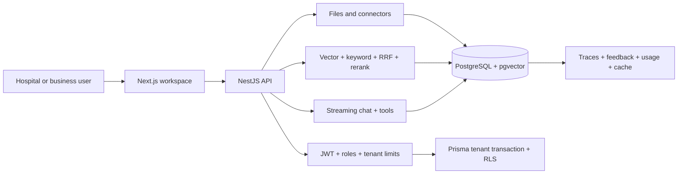

# Aegis RAG

**A production-minded, multi-tenant RAG platform for hospitals, healthcare operations, and other regulated or multi-client businesses.**

Aegis turns internal policies, procedures, product documentation, databases, APIs, and websites into a tenant-isolated knowledge workspace. Answers stream with exact source citations, while administrators can inspect every retrieval stage instead of trusting an opaque response.

> Aegis is an engineering foundation, not a claim of HIPAA, SOC 2, or other regulatory certification. A production deployment still requires the operating organization’s security, privacy, retention, and compliance controls.

## Why Aegis

Naive RAG fails silently: weak context goes into a model, a confident answer comes out, and nobody can explain why. Aegis makes the failure modes visible and measurable.

- Hybrid retrieval catches both conceptual matches and exact identifiers such as `IPC-104`.
- Reranking promotes the strongest evidence before generation.
- Citations show the document and exact snippet behind an answer.
- Retrieval traces expose only executed stages with their original per-stage scores, candidates, ranks, reformulated queries, provider fallbacks, and measured latency.
- Feedback, golden-question evaluation, usage tracking, and answer caching support an improvement loop.
- PostgreSQL row-level security prevents one tenant from reading another tenant’s data.

## Features

- JWT access and rotating/revocable refresh tokens, Argon2 password hashing, roles, global IP throttling, and PostgreSQL-backed per-tenant rate limits shared across replicas.
- Tenant-scoped Prisma transactions backed by PostgreSQL row-level security.
- Restricted runtime database role plus integration tests proving raw reads and writes cannot cross tenants.
- TXT, Markdown, CSV, JSON, PDF, and DOCX ingestion with version replacement.
- Centralized email/phone redaction and prompt-injection rejection for files and every connector source, plus upload MIME/signature validation.
- REST API, read-only PostgreSQL, and bounded website/sitemap connectors with scheduled sync.
- Explicit `aegis-hash-384` deterministic local embeddings, pgvector similarity search, PostgreSQL full-text search, and reciprocal-rank fusion; unsupported model identifiers are rejected rather than silently mixed in one index.
- Optional Cohere reranking with a local `ms-marco-MiniLM-L-6-v2` cross-encoder fallback. If its model is not cached and cannot be downloaded, traces explicitly report the lexical emergency fallback.
- Swappable generation-provider interface with Groq timeout/rate-limit handling and a guaranteed free local fallback.
- SSE streaming chat, structured citation cards, one-pass weak-context query rerouting, and tenant-scoped near-duplicate semantic caching.
- Admin retrieval trace viewer, thumbs-up/down feedback, provider-aware query metering and cost dashboard, optional idempotent billing webhook milestones.
- Intent-gated `create_ticket` tool with persisted tickets and trace entries.
- Golden Q&A evaluation command, Jest tests, and GitHub Actions CI.

All required infrastructure and fallback logic can run locally with free, open-source tools. Cohere, Groq, and the billing webhook are optional.

## Architecture



```text
apps/backend   NestJS API, Prisma schema, migrations, seed, tests
apps/frontend  Next.js workspace and admin screens
eval           Golden Q&A dataset and regression runner
docs           Demo and deployment walkthroughs
```

## Stack

- Next.js 16 and React 19
- NestJS 11, Passport JWT, and Prisma 6
- PostgreSQL 16 with pgvector
- Docker Compose and GitHub Actions

## Quick start

Requirements: Node.js 22+, npm, and Docker with Compose.

```bash
git clone https://github.com/Muhammad-Tayyab1/aegis-rag.git
cd aegis-rag
cp .env.example .env
```

Set secure values in `.env`. Generate the connector encryption key with:

```bash
openssl rand -hex 32
```

Then install, start PostgreSQL, migrate, seed, and run both applications:

```bash
npm install
docker compose up -d postgres
npm run db:migrate
npm run db:seed
npm run dev:api
```

In another terminal:

```bash
npm run dev
```

Open `http://localhost:3000`. The API is at `http://localhost:4000/api`. Seeded emails are `admin@aegis.local` and `member@northwind.local`; passwords are the values you set in `SEED_ADMIN_PASSWORD` and `SEED_MEMBER_PASSWORD`.

For containerized startup after configuring `.env`:

```bash
docker compose up --build
```

## Configuration

| Variable                                                                  | Purpose                                                   | Required                  |
| ------------------------------------------------------------------------- | --------------------------------------------------------- | ------------------------- |
| `DATABASE_URL`                                                            | PostgreSQL connection with pgvector enabled               | Yes                       |
| `JWT_SECRET`                                                              | Access and refresh-token signing secret                   | Yes                       |
| `CONNECTOR_ENCRYPTION_KEY`                                                | 32-byte hex key for stored database connector credentials | For PostgreSQL connectors |
| `WEB_ORIGIN`                                                              | Comma-separated allowed browser origins                   | Recommended               |
| `TENANT_RATE_LIMIT_PER_MINUTE`                                            | Per-tenant API limit                                      | No; defaults to 120       |
| `SEMANTIC_CACHE_SIMILARITY`, `SEMANTIC_CACHE_TTL_HOURS`                   | Cache match threshold and lifetime                        | No                        |
| `GROQ_API_KEY`, `GROQ_MODEL`                                              | Optional hosted answer generation                         | No                        |
| `GROQ_INPUT_USD_PER_MILLION_TOKENS`, `GROQ_OUTPUT_USD_PER_MILLION_TOKENS` | Configurable Groq metering rates                          | No; defaults to free      |
| `COHERE_API_KEY`, `COHERE_RERANK_MODEL`, `LOCAL_RERANK_MODEL`             | Hosted or local cross-encoder reranking                   | No                        |
| `BILLING_QUERY_THRESHOLD`, `BILLING_WEBHOOK_URL`                          | Optional usage notification                               | No                        |
| `EVAL_API_URL`, `EVAL_TOKEN`                                              | Golden-set evaluation target and tenant access token      | For `npm run eval`        |
| `SEED_ADMIN_PASSWORD`, `SEED_MEMBER_PASSWORD`                             | Passwords used by the seed script                         | For seeding               |

See [.env.example](.env.example) for the complete template. Never commit `.env`.

## Connect data

- Upload documents from the Documents screen. The server enforces a 10 MB limit and supported extensions.
- Add an HTTPS REST endpoint from Connectors. REST and crawler sync reject private/special-use network targets and revalidate redirects.
- Add a website or sitemap crawler. Crawling is HTTPS-only, same-origin, capped at 20 pages, and blocks private/special-use network targets.
- Create a PostgreSQL connector through the API with a connection string and one read-only `SELECT` query. The connection string is encrypted before storage.

Connectors can be synced manually and REST/crawler sources are refreshed hourly. Re-ingesting the same logical source replaces its old chunks so stale duplicates do not accumulate.

## Retrieval flow

1. Create a deterministic 384-dimension query embedding.
2. Run tenant-scoped pgvector and full-text searches in parallel.
3. Combine ranks with reciprocal-rank fusion.
4. Rerank with Cohere when configured, otherwise use the local lexical scorer.
5. Retry once with a more specific query when evidence is weak.
6. Generate from the retrieved context and stream the answer with citations.
7. Persist query usage and stage-level traces; cache eligible answers for 24 hours.

Retrieved text is explicitly framed as data, not instructions, in the generation prompt.

## Main screens

| Path          | Purpose                                           |
| ------------- | ------------------------------------------------- |
| `/documents`  | Upload and manage tenant documents                |
| `/register`   | Join an existing tenant workspace                 |
| `/connectors` | Configure and synchronize external sources        |
| `/chat`       | Stream grounded answers, citations, and feedback  |
| `/traces`     | Admin-only retrieval debugger                     |
| `/settings`   | Admin tenant retrieval and chunking configuration |
| `/usage`      | Query, token, and estimated-cost totals           |
| `/tickets`    | View tool-created tenant tickets                  |

## Evaluation and validation

The example golden cases correspond to the documents in `eval/fixtures`. Upload those fixtures to the `aegis-demo` tenant, or replace the cases with tenant-specific questions and source filenames, authenticate as that tenant, and run:

```bash
EVAL_TOKEN=your-access-token npm run eval
```

The evaluator verifies the token's tenant, reports retrieval hit rate separately from answer accuracy, optionally checks expected source filenames, and emits `EVAL_REPORT_JSON` for CI ingestion. Run the same checks used in CI with:

```bash
npm run prisma:generate
npm test
npm run test:eval
npm run test:integration # requires TEST_DATABASE_URL with migrations applied
npm run lint
npm run build
```

The integration command is intentionally not reported as passing when Docker/PostgreSQL is unavailable. Start Docker first, apply migrations to `TEST_DATABASE_URL`, and run it before a release.

## Deploying against a client’s existing PostgreSQL instance

1. Confirm PostgreSQL supports the `vector` extension and that the deployment user may enable it.
2. Set `DATABASE_URL` to the client-managed database; do not change application code.
3. Run `npm run db:migrate` using a migration identity with schema privileges.
4. Run the API with a lower-privilege runtime identity where the client’s policy requires it.
5. Set unique production values for JWT and connector encryption keys, restrict `WEB_ORIGIN`, and terminate TLS at the ingress.
6. Keep database backups, retention, audit collection, key rotation, and incident response under the client’s controls.

When using Docker Compose, set `DATABASE_URL` to the external URL and start only the application services with `docker compose up --build backend frontend`; the local `postgres` service is then neither started nor required. The application’s tenant schema, RLS policies, and retrieval code remain unchanged.

## Demo

The [90-second demo walkthrough](docs/DEMO.md) provides setup, narration, and a shot list covering ingestion, exact-ID hybrid retrieval, streaming citations, traces, rerouting, usage, and tool calling. The recording is intentionally not represented as complete until `docs/aegis-rag-demo.mp4` or `docs/aegis-rag-demo.gif` is captured from a running stack.

## Design boundaries

- The built-in embedding and generation fallbacks make the repository free to run and easy to evaluate; production teams can replace them behind the existing service boundaries.
- The PII and prompt-injection filters are basic safeguards, not a complete data-loss-prevention or content-security system.
- Connector SSRF restrictions reduce risk but do not replace deployment-level egress policies.
- Billing integration is intentionally a webhook rather than a mandatory paid provider.

## License

This repository is currently unlicensed. Add an explicit license before reuse or distribution.
